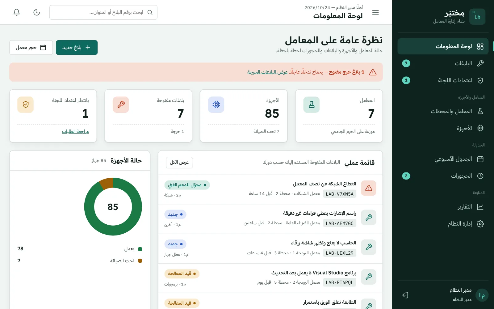
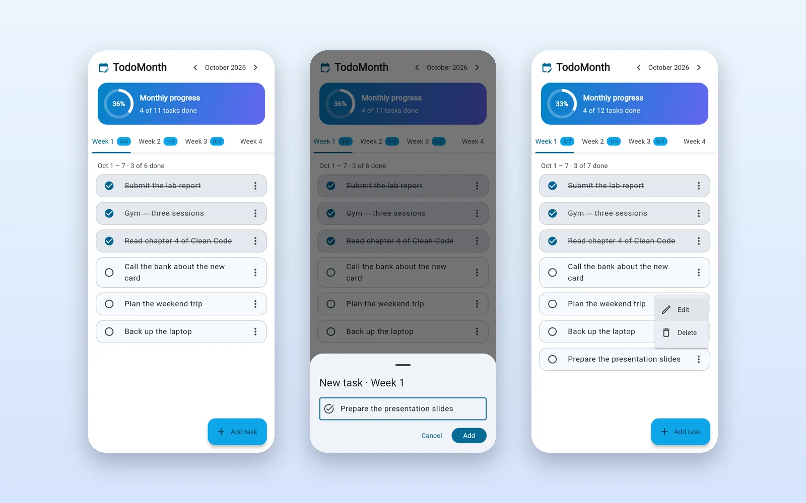
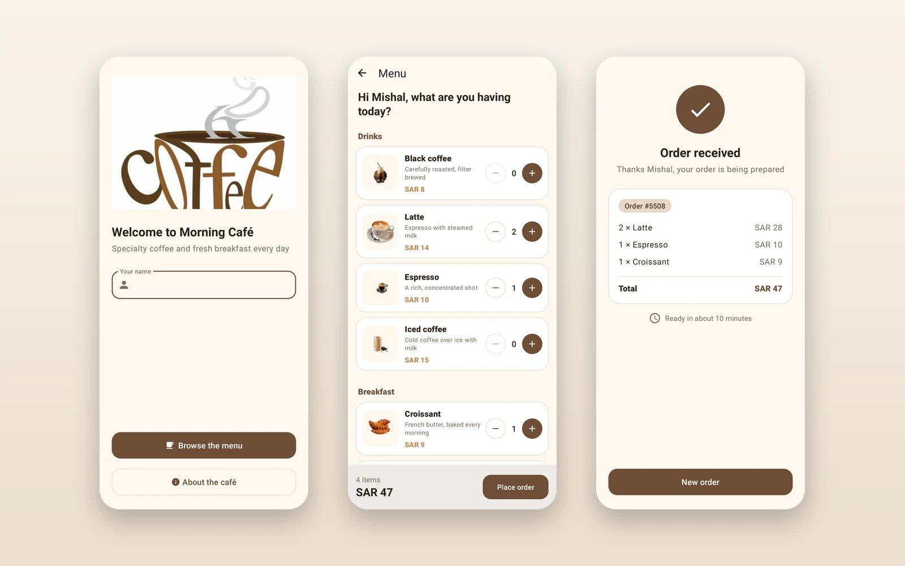
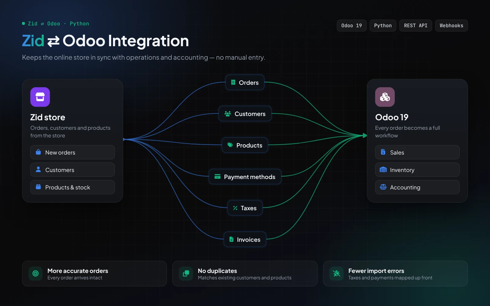

  

  
  
  
  

## 🧑‍💻 About me

I turn business needs into working software — web and mobile apps, backend systems, and **Odoo ERP** with custom integrations and approval workflows.

- 💼 **IT Specialist @ Droua Alsaoud Company** — leading the Odoo ERP rollout and the Zid–Odoo integration
- 🛠️ Before that: **Development Technical Supervisor** @ Whiteland · **Software Engineer (volunteer)** @ Bedar Charity · **Mobile Developer intern** @ The Garage
- 🎓 **B.Sc. Information Technology** — Jazan University
- 🌍 Arabic (native) · English

## 🚀 Featured work

<table>
  <tr>
    <td width="50%" valign="top">
      
      <h3>🧪 Lab Management System</h3>
      Graduation project — labs, stations and devices with a three-level issue workflow, committee approvals, conflict-free bookings and RBAC. 
      <b>Symfony 7 · Doctrine · MySQL · Twig · Docker</b>
    </td>
    <td width="50%" valign="top">
      
      <h3>✅ <a href="https://github.com/MishalTouhiri/ToDo">TodoMonth</a></h3>
      Plan a month week by week — progress ring, swipe to delete with undo, saved tasks, light/dark, Arabic &amp; English. <a href="https://mishaltouhiri.github.io/ToDo/"><b>Live demo →</b></a> 
      <b>Flutter · Dart · Material 3 · Widget tests</b>
    </td>
  </tr>
  <tr>
    <td width="50%" valign="top">
      
      <h3>☕ <a href="https://github.com/MishalTouhiri/My-projict">Morning Café</a></h3>
      Android ordering app — menu with quantities and a live total, receipt screen, Arabic &amp; English. 
      <b>Java · Android · Material 3 · Robolectric</b>
    </td>
    <td width="50%" valign="top">
      
      <h3>🔗 Odoo integrations</h3>
      Zid ⇄ Odoo and Foodics → Odoo connectors, plus multi-stage approval workflows. <i>Work projects — source private.</i> 
      <b>Odoo 19 · Python · REST APIs</b>
    </td>
  </tr>
</table>

## 🧰 Tech stack

    
    
    
  

## 🐍 Contributions

<picture>
  <source media="(prefers-color-scheme: dark)" srcset="https://raw.githubusercontent.com/MishalTouhiri/MishalTouhiri/output/snake-dark.svg">
  
</picture>

---

**مشعل طوهري** — مهندس برمجيات وأخصائي تقنية معلومات. أبني تطبيقات الويب والجوال والأنظمة الخلفية، وأطبّق Odoo مع تكاملات وسير موافقات مخصّصة. 
📫 <a href="mailto:MishalTouhiri@gmail.com">MishalTouhiri@gmail.com</a> · <a href="https://mishaltouhiri.vercel.app">البورتفوليو</a>

